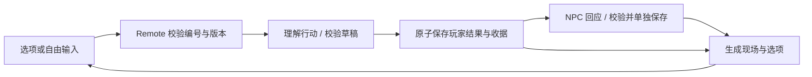

# 架构

本项目有两条产品线。**主线是 `packages/dsh-tg` 插件**；`src/` + `server/` 是已冻结的旧版网页工程。

| | 主线插件 | 旧版网页 |
| --- | --- | --- |
| 位置 | `packages/dsh-tg/` | `src/`、`server/` |
| 运行形态 | Harness 面板，Host 持有状态 | 单页 HTML + 本地 Node 服务 |
| 语言 | TypeScript + React | JavaScript + SugarCube-2 |
| 状态权威 | Host 存储域 | 浏览器 `State.variables` / localStorage |

---

# 一、主线：DeepSeek Harness 原生插件

## 分层

| 层 | 文件 | 职责 |
| --- | --- | --- |
| 状态合同 | `src/core/schema.ts` | Zod 定义世界、行动、NPC 提议、存档，并做交叉引用校验 |
| 内容与初始世界 | `src/core/world.ts`、`src/content/` | 4 个区域、12 个地点、角色卡、照片任务、商品与初始属性 |
| 规则 | `src/core/rules.ts` | 路线与耗时、物品、任务、知识、属性阈值、生成地点/人物 |
| 提交流程 | `src/core/service.ts` | 每局串行队列、请求收据、版本与代次、分阶段持久化、取消、恢复 |
| 上下文 | `src/core/context.ts` | 按阶段和知情人裁剪模型可见信息 |
| 轨迹 | `src/core/trace.ts` | 结算 diff 与调用索引 |
| 模型接入 | `src/host/model.ts`、`src/host/model-choice.ts` | 宿主 Agent、系统提示、游戏工具、跟随 DSH 当前模型 |
| 宿主接缝 | `src/host/index.ts`、`src/rpc.ts` | Cordis 服务、类型化 Remote、两个存储域 |
| 界面 | `src/client/` | 现场、管理页、对话、调用记录 |

`src/core` 不依赖 React、Cordis、DOM 或 SugarCube，可在测试中独立运行。

## 一次行动的生命周期



1. `submitAction` 接收 `gameId/requestId/expectedRevision` 与选项编号或文字。同一请求编号只认可同一输入，重复提交返回原快照；不同请求用过期版本则拒绝。
2. 模型把意图整理成规则步骤。目标不明不结算；调查未找到新线索仍结算时间。同组并发步骤取最大耗时，前后组累加。
3. 所有步骤先在 `structuredClone` 草稿上运行，任一前置条件不通过就整份丢弃；成功才把世界、阶段与收据作为同一条记录保存。
4. 每个 NPC 的回应独立校验、独立提交，`replied` 记录已提交者。礼物、金钱与任务只生成提议，玩家接受时才转移资源。
5. 现场生成不改世界。失败时保留事实描述，可补齐回应/现场或开始新行动。取消、读档、恢复与新行动都会推进代次，旧结果无法覆盖新状态。

模型每阶段至多 5 次请求、12 次工具调用；工具只能暂存候选（`STAGED`）或返回校验失败（`REJECTED`），最终提交由服务完成。模型即使已提交候选，若原生 Agent 以错误或取消结束，该阶段仍判失败。

## 状态、存储与并发

- 存储域 `tg_game_v1`：`games` 表每局一条完整记录，`saves` 表 0–7 八个栏位。
- 存储域 `tg_traces_v1`：调用索引；原始模型事件仍由 Harness 会话持久化保存。
- `revision` 做乐观并发，`generation` 标记运行代次，`receipts[requestId]` 保证幂等。
- 浏览器只保存「上次打开的游戏编号」，不保存有效进度；刷新后从 Host 读完整快照。
- 读档保留本机结算历史并追加恢复标记；导入别人的存档不会导入其原始模型日志。

## 上下文与知情范围

`buildActionContext` / `buildNpcContext` / `buildSceneContext` 分别产出三个阶段的数据视图。记忆条目带 `knownBy`，**权限先于相关性**：NPC 阶段只能看到该人物已知的事实，不包含其他人物对话、玩家私有背包或未汇报的任务进度。

三个阶段的提示词互相独立，可被 `${DSH_HOME}/tg/prompts` 下的六个外部模板覆盖（热更新，坏模板回退到上次有效版本）。资料在系统提示中分段插入，工具提交要求仍由程序校验，改模板不改变结算规则。

## 边界

- Host 是唯一状态权威。
- 模型不能直接改状态，只能建议；规则拒绝会作为「已完成的非消耗行动」返回给玩家。
- 渲染阶段不修改世界；效果只随已确认的行动结算。

实现细节见 [迁移说明](deepseek-harness-migration.md)，上下文规则见 [上下文与经历](deepseek-harness-context.md)，调用记录见 [调用记录](deepseek-harness-traces.md)。

---

# 二、旧版：Twine + SugarCube-2 网页工程

> 2026-09-29 起冻结。保留旧存档、旧玩法与内容数据源，不再开发新功能。

## 数据流

```
Twee passages (.twee)  ──────┐
User scripts (.js)     ──────┼──▶  Tweego  ──▶  dist/index.html  ──▶ Node 后端托管 (server/index.js)
CSS modules (.css)     ──────┘
```

运行时：

```
浏览器 (dist/index.html, http://localhost:3000)
   ├─ POST /api/llm  ──▶ server/llm-proxy.js ──▶ Ollama / OpenAI
   └─ POST /api/log  ──▶ server/logger.js ──▶ logs/*.jsonl + stdout
```

## Passage 类型

| Passage | 用途 |
| --- | --- |
| `StoryInit` | 初始化 `$player`、`$time`、`$location`、`$world`、`$game`、`$theme`、LLM 状态 |
| `StoryCaption` | 每条 passage 渲染的侧边栏状态栏 |
| `StoryMenu` | 侧边栏导航链接 |
| `PassageHeader` / `PassageFooter` | 每条 passage 的设置与清理钩子 |
| `Start` | 开场 |
| `Bedroom`、`Street`、`Park`、`Shop` | 地点场景 |
| `Settings` | 保存/读取与配置 UI |
| `Character` / `QuestLog` | 角色技能与关系、任务日志 |
| `LLMConfig` | LLM 配置页 |
| `DynamicScene` / `LLMGateway` | 动态生成场景的渲染与路由 |
| `Mod Test` | Mod 接口演示 |

## JavaScript 模块

- `engine.js` — `ModAPI`、`ThemeEngine`、`advanceTime()`、`<<action>>` 宏、事件钩子
- `save-system.js` — 基于 SugarCube `Save` 的 `CustomSave` 封装
- `settings.js` — `Setting` 定义
- `pixel-images.js` — 确定性 SVG 像素图与 `<<sceneimg>>`
- `llm-client.js` — `LLMEngine`，调用后端 `/api/llm`
- `logger.js` — 前端日志上报，包装 `console.*` 与全局错误
- `llm-prompts.js` — `PromptBuilder`，从游戏状态组装中文提示词
- `llm-ui.js` — `NarrativeUI`，叙事渲染、等待指示器、错误横幅
- `llm-structured.js` — `LLMStructured`，JSON 生成、解析、校验与 fallback
- `llm-macros.js` — `<<llmconfig>>`、`<<llmscene2>>`、`<<llmnpc>>`、`<<llmquest>>`、`<<npcchat>>`、`<<hubscene>>`
- `movement.js` — `RegionSystem` + `MoveTool`，两级位置注册与移动校验
- `quest-engine.js` — `TaskEngine`，任务迁移、进度校验、交付与幂等奖励
- `quest-events.js` — 任务现场与事件证据
- `npc-state.js` / `npc-agency-state.js` / `npc-tools.js` / `npc-director.js` — NPC 数据、提议、资源与决策队列
- `llm-tool-runner.js` / `llm-operation-scope.js` / `llm-trace.js` — 多轮工具执行、请求归属与轨迹
- `scene-actions.js` / `scene-option-tools.js` / `action-ui.js` / `target-cursor.js` / `debug-panel.js` — 场景交互与调试

## 状态模型

所有游戏状态存在 SugarCube 的 `State.variables`：

- `$player`、`$time`、`$world`、`$theme`、`$modRegistry`
- `$location`（大区域 ID，兼容旧代码）与 `$position`（两级位置）
- `$regions` — 大区域、子区域、别名与连接注册表
- `$llmConfig`、`$llmHistory`、`$llmSession`
- `$generatedScenes`、`$dynamicSceneId`、`$npcs`、`$activeNPCId`、`$npcAgency`
- `$quests`、`$activeQuestId`、`$worldMemory`

## Mod API

```javascript
ModAPI.loadModData({
  name: '我的 Mod',
  version: '1.0.0',
  css: '#ui-bar { border-color: #ff0 !important; }',
  script: 'console.log("我的 Mod 已加载");',
  hooks: {
    passageStart: function () { /* ... */ }
  }
});
```

## LLM 集成（旧版）

叙事生成：`<<hubscene>>` → `PromptBuilder` → `LLMEngine` → 后端 `/api/llm` → `NarrativeUI` → DOM。代理是非流式的，拿到完整回复后一次性渲染。

结构化生成：`<<llmscene2>>` / `<<hubscene>>` / `<<llmnpc>>` → `LLMStructured.generateJSON` → `$generatedScenes` / `$npcs` / `$quests` → 场景或对话渲染。

移动统一经 `MoveTool.invoke()`；任务进度统一经 `TaskEngine`；生成选项的 `effects` 只在玩家点击后应用。历史按 `channel` 隔离：`scene`、`chat`、`npc.dialogue`。

详见 [LLM 集成](llm-integration.md) 与 [LLM 内容生成](llm-content.md)。

## 后端

`server/` 是零依赖 Node 服务（`node:http` + 全局 `fetch`）：

- `GET /` 托管 `dist/index.html`
- `POST /api/llm` 代理到 Ollama 或 OpenAI 兼容 API
- `POST /api/log` 接收前端日志，写 `logs/game.jsonl`
- LLM 请求/响应/错误写 `logs/llm.jsonl`，HTTP 生命周期写 `logs/server.jsonl`
- 前端传入 `model`/`temperature`/`maxTokens`/`prompt`；`provider`/`endpoint`/`apiKey` 留在后端

无鉴权、无 Origin 校验、无限流，定位是本地开发服务。公开部署前必须补访问控制。正文默认只存 300 字预览。

## 主题

主题是编译进 HTML 的 CSS；`ThemeEngine.setTheme(name)` 在根元素设置 `data-theme` 切换，并可注册主题资源。

## 构建说明

Tweego 的包含规则和 `--head` 作用域问题见 [build-notes](build-notes.md)。