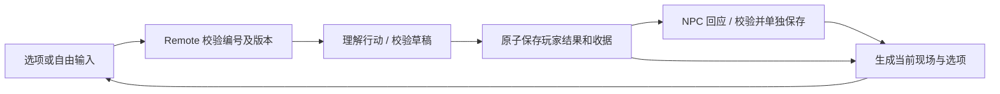

# TG → DeepSeek Harness 迁移实现

实现位于 `packages/dsh-tg`，旧网页工程、旧存档和已有未提交修改保留。当前源码交付版本 `0.6.0`，在[分阶段上下文与结构化经历](deepseek-harness-context.md)基础上增加外部提示词热更新与独立 NPC 对话模式；依赖锁定 Harness `0.2.1-rc.2` 与 Cordis `4.0.5`。本机 desktop 已安装 `0.6.0`（2026-10-26），原 Web 安装保持 `0.1.6`。下文桌面初次适配记录对应 `0.2.1` 插件及 Harness `0.2.0-rc.2`，不代表后续版本已在旧宿主复验。

## 官方基线

初版依据官方标签 `dsh-v0.1.5-rc.2`，提交 `fb2c4b9e698e30edb738bca4cf0618587db7d203`，并对照本机安装包的实际类型与实现：

- [打包指南](https://github.com/deepseek-ai/deepseek-harness/blob/fb2c4b9e698e30edb738bca4cf0618587db7d203/docs/user/develop/basic/publish.md)：单包 Host/Client、bundle 补丁、预编译产物。
- [界面扩展](https://github.com/deepseek-ai/deepseek-harness/blob/fb2c4b9e698e30edb738bca4cf0618587db7d203/docs/subsystems/slots.md)：`sidebar.panellist` 与 `main` 的同一 `tg-game` 标识。
- [Remote](https://github.com/deepseek-ai/deepseek-harness/blob/fb2c4b9e698e30edb738bca4cf0618587db7d203/docs/api-gateway.md)：`TypertRemoteService`、`@Remote`、显式 descriptor、宿主认证与结果包装。
- [工具](https://github.com/deepseek-ai/deepseek-harness/blob/fb2c4b9e698e30edb738bca4cf0618587db7d203/docs/user/develop/basic/tool.md)和[存储](https://github.com/deepseek-ai/deepseek-harness/blob/fb2c4b9e698e30edb738bca4cf0618587db7d203/docs/subsystems/storage.md)：独立 Agent 作用域、带 schema 的结构化领域表。

桌面适配以本机官方 `0.2.0-rc.2` 安装包为准，其构建提交为 `04f392c9ddd144fa426da2045178797da6db6c11`。开发依赖固定为该版本及 Cordis `4.0.4`，peer 范围只列出这两个明确支持的宿主版本。安装方式对照[官方桌面说明](https://github.com/deepseek-ai/deepseek-harness/blob/master/apps/desktop/README.md)，实现细节与实测记录见[桌面版报告](deepseek-harness-desktop-validation.md)。

### 桌面适配差异

- 桌面渲染器仍使用 `web` 客户端扩展协议，保留 `dsh.client.platform: web`、侧栏和主面板注册；通过宿主连接访问 Remote，无固定端口或外置 Web 服务。
- Remote codec 同时提供旧版 `schema` 和新版惰性 `create()`，两者共用同一校验规则。Agent 的游戏输入使用新版接受的 `source.kind: user`，游戏作用域与工具隔离保持不变。
- `scripts/manage-desktop.ps1` 只通过桌面安装目录中的 CLI 管理保留的 `desktop` profile；先验证版本与进程退出，再备份配置和锁文件并安装/卸载。旧 Web 脚本拒绝用于该 profile，桌面安装不添加 Web 实时重载补丁。
- 不变更存档结构。默认共享同一 DSH home 时可以读取原有旅程；两种宿主不要并发写同一 JSON 存储。

## 模块与数据权威

| 模块 | 文件 | 职责 |
| --- | --- | --- |
| 状态合同 | `src/core/schema.ts` | 状态、行动、NPC 提议、存档结构及交叉引用校验 |
| 内容和初始世界 | `src/core/world.ts`、`src/content` | 4 个区域、12 个地点、晚晴和亨特资料、照片任务、商品与初始属性 |
| 规则 | `src/core/rules.ts` | 路线、行动耗时、物品、任务、知识、属性、生成地点/人物与世界事件 |
| 提交服务 | `src/core/service.ts` | 每局串行队列、请求收据、版本、运行代次、分阶段持久化、取消与恢复 |
| 模型 | `src/host/model.ts` | 宿主 Agent 上下文和游戏工具；不调用旧 LLMToolRunner |
| 宿主接入 | `src/host/index.ts`、`src/rpc.ts` | Cordis 服务、类型化 Remote、存储域与卸载清理 |
| 界面 | `src/client` | 展示完整快照、自由输入、选项、管理页、轮询与重连 |

Host 是唯一游戏状态权威。核心规则不依赖 `State.variables`、SugarCube、页面切换或 DOM。浏览器只保留“上次打开的游戏编号”，不保存有效游戏进度。

## 一次行动怎样提交

1. `submitAction` 接收 `gameId/requestId/expectedRevision` 和选项编号或文字。同一请求编号只认可同一输入。收据先于版本检查，重复请求返回当前完整快照，其中保留原行动收据；不同请求使用过期版本则拒绝。
2. 模型把意图整理成规则步骤。目标不明、无法执行不结算；实际调查未找到新线索仍结算时间。同一组同时发生的步骤按最大耗时，前后组相加。
3. 所有步骤先在独立草稿上运行，任何前置条件不通过均不写入。成功时将世界、行动阶段和收据作为同一游戏记录保存，随后才开始 NPC 回应。
4. 每名 NPC 的回应通过检查后独立提交，`replied` 记录已提交者。新礼物、金钱与任务只生成提议，接受时才扣 NPC 资源、增加玩家物品或接任务。
5. 现场生成不改变世界。失败时保留事实描述，用户可补齐回应/现场，或开始新行动。取消、读档、恢复中断与新行动推进运行代次，旧结果无法覆盖新状态。

模型每阶段至多 5 次请求、12 次工具调用。`tg_read_context` 只能读本阶段上下文，`tg_propose_result` 只暂存已校验候选；最终提交由服务负责。即使已有候选，如果原生 Agent 最终以错误/取消结束，本阶段仍失败。完成后释放 Agent 与监听器。

## 玩法边界

- 普通耗时 1/5/15/30 分钟；路线由登记数据决定，同区 5、跨区 15。发现地点只登记双向路线，移动成功才换位置。
- 时间以绝对分钟累计。跨天保留当前位置和调查、交谈、任务；不会回家或自动恢复。睡眠按实际分钟每小时恢复 10 体力、减少 2.5 压力，属性有上下限。
- 包含购物、吃食物、学习、锻炼、休息、睡眠、等待、房租、属性阈值和结束状态。新人物在当前地点登记，不虚构与玩家的共同历史或起始财物。
- 多轮调查记录持续保存；找到照片和交还照片分别留下事实。任务保留进行中、暂时阻塞、完成、结束未完成四种状态；接受、拒绝和放弃均走行动入口。
- NPC 上下文只含其人物资料、自有资源、已知事实、自己的对话和提议。不包含其他人物对话、玩家私有背包或未告知的任务完成细节。
- 原来的环境事件概率 25% 保留，由保存的随机种子决定机会；事件提议和有限的属性变化跟玩家行动一起校验、提交。不会再从时间回调额外发起游离模型请求。跨天天气变化与租金提醒由程序处理。
- 原版中文角色卡、世界条目、地点描述、深浅主题变量与像素素材算法已迁移。旧宏、Mod API、演示页面和旧存档格式不是兼容接口；旧格式仍留在原工程。

## Remote、存储和界面

提供 `models/listGames/createGame/getGame/submitAction/cancelAction/retryOutput/listSaves/saveGame/loadGame/exportSave/importSave/configure`。

`src/rpc.ts` 的同一 Zod 合同生成 Host descriptor 表和 Client mount 数据，是显式维护的合同表，不声称由官方 Typert 编译器生成。Host 方法使用标准 `@Remote` 标记。Client 先 mount，再注入 `remote.tg`，最后解包 `RemoteResult`；失败信息交给界面显示。

结构化存储域为 `tg_game_v1`，`games` 表每局一个完整记录，`saves` 表 0–7 共八栏。每次阶段提交自动保存，聊天历史不作存档。导入校验位置、路线、物品、人物、任务和已结算阶段的一致性。

界面处理期间每秒读取完整快照，结束即停止；恢复连接或窗口回到前台时再读取。背包、角色、地图、日志均只读；设置可选宿主模型、主题和新开局。原生 Remote、Agent、域句柄和组件订阅随 Cordis 作用域释放。

## Web 安装和运行中更新

详见 [插件 README](../packages/dsh-tg/README.md)。安装脚本备份 profile 后调用当前 CLI，使用 `cordis.patch.yml` 中的受管块加载。当前版本的实时 composer 不重新读 bundle 列表，因此运行中安装不能只靠新增 `dsh.bundle`。

更新采用带版本参数的文件入口和带版本的 Loader id，避免 Node 重用旧模块及 rc.2 修改同一条目名称留下旧客户端来源。当前宿主先创建新条目再删除旧条目，因此安装器分两步：先撤销旧 TG，利用临时观察器确认旧服务消失且存储域可正常打开并关闭，再加载新版；超时恢复原补丁。只替换 TG 的块，观察器随安装完成撤销。卸载先撤销该块，再移除依赖，保留存档和其他插件。没有降低认证、读出模型密钥或终止已有 Harness 任务。

## 验证与交付

`npm test` 现有 53 项，覆盖计时、照片、提议、NPC 知识、并发、取消、迟到结果、重试、恢复、导入、原子写失败、模型上限、独立对话模式与提示词热更新。`npm run pack:plugin` 完成类型检查、装饰器转换、打包与运行语法检查。

桌面版的真实模型、安装和界面检查以[桌面版报告](deepseek-harness-desktop-validation.md)为准。原 Web 版的历史检查保留在[早期验证报告](deepseek-harness-validation.md)。没有重跑的项目明确保留其验收边界，不以单元测试代替运行结果。
