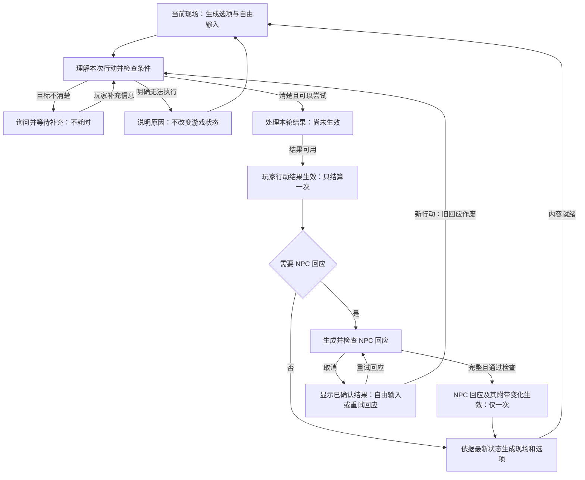

# 游戏状态重构讨论

创建日期：2026-09-29

更新日期：2026-09-30

状态：讨论中，尚未开始修改游戏逻辑。

## 文档记录方式

- 只记录已经讨论确定的结论。
- 没有确定的事项只标记“待讨论”，不写入候选方案、推荐方案或具体设计。
- 方案先在对话中讨论，确定后再更新本文。

## 重构目标

整体重构游戏状态，让场景、行动、任务交付和时间流转更加清晰。

需要解决的问题：

- 固定选项和生成选项混杂。
- 固定场景和生成场景混杂。
- 任务交付和对话混杂。
- 时间流失不连贯。

## 已确定

### 行动选项

世界内的行动选项由当前情境生成，不再另外提供固定的移动、睡觉、购买等玩法按钮。

固定界面只保留背包、设置等管理功能。

### 自由输入

保留自由输入。玩家既可以点击生成选项，也可以输入选项之外想做的事情。

自由输入按以下四种情况处理：

| 情况 | 处理方式 |
| --- | --- |
| 意思清楚、条件满足 | 直接执行，无需再确认一次。 |
| 目标不清楚 | 询问缺失的信息，澄清不耗时。例如现场有两个人，玩家说“把照片给她”，就询问指的是谁。 |
| 明确无法执行 | 说明原因，不扣时间、不改变状态。例如背包里没有照片，就不能执行递交照片。 |
| 实际尝试了但没成功 | 仍消耗实际行动的时间，并记录尝试。例如搜索了 15 分钟却没找到东西，仍记录这次搜索和耗时。 |

输入不清楚与角色实际行动失败分别处理。

### 地点与地图

保留“大区域 → 具体地点”的结构，例如“公园 → 入口、喷泉、长椅”。

预先设计的地点与 AI 生成的地点采用相同规则，都记录名称、所属区域和连接路线，之后可以再次到访。

地点的基本信息保持稳定，现场描述根据最新状态生成。人物、任务进展和已经发生的事情决定当前看到什么。

只有移动行动成功，玩家位置才改变。生成新遭遇不会自动换地点；出现可前往的新地点，要先登记并建立路线。

例如在公园长椅旁聊天，接着调查椅子下面，始终是在同一个地点；发现通往旧亭子的小路后，选择沿路过去，才切换到旧亭子。

### 场景与行动

采用连续推进的玩法：玩家做一次行动，游戏给出结果，再根据最新情况继续选择下一次行动。

探索、观察、调查等不单独划分成不同玩法模式。游戏持续记录玩家在哪里、已经发生了什么，以及哪些事情还没有做完。

换地点后显示新地点的现场，保留已经发生的结果和未完成事项；返回时根据最新情况继续，不随意重置此前经历。

### 多轮事情

一件事可以持续多轮，每轮只处理玩家本次选择的行动。每轮之后继续提供生成选项和自由输入。

游戏保留已经做过的行动、发现的线索和当前进展，下一轮接着已有情况推进。

是否完成取决于实际结果，不按固定点击次数结束。

### 中途离开与返回

离开时保留进展，包括已经发现的线索、做过的行动和说过的话。

能否继续取决于实际条件。普通调查回来可以接着做；有期限的事情、需要某人在场的互动，要检查时间和人物是否仍在。

返回时，根据保留的进展和已经发生的变化生成最新描述与选项。变化必须有明确的时间条件或事件依据。

例如搜过抽屉后离开，回来可以继续搜柜子；约好等到 18 点的人，超过约定时间可能已经离开，但之前的交谈仍然保留。

### 事情的状态与结束

一件已经开始的事情区分以下四种状态：

| 状态 | 含义 |
| --- | --- |
| 进行中 | 还没完成，可以继续推进。 |
| 暂时无法继续 | 人不在、地点未开放等，条件恢复后可以继续。 |
| 已完成 | 已满足完整完成条件，包括必要的交付。 |
| 已结束但未完成 | 明确过期、玩家主动放弃，或必要条件永久失效。 |

离开现场不等于放弃，NPC 暂时离开也不等于任务失败。取消生成只停止尚未完成的处理，不代表主动放弃这件事。

结束时保留已经发生的经过，记录结束原因，停止提供已经失效的行动。具体后果按这件事明确的规则处理，不因为刷新场景就重新开始。

### 选项、对话与交付

采用“一个现场、一套行动入口，程序统一处理结果”的方式。

生成选项与自由输入走同一条行动流程。点击“归还照片”和输入“把照片还给她”，都识别为交付行动；能否执行，由程序检查人物、物品和任务条件。

对话、调查、移动、交付等都作为行动。玩家可以只说话，也可以边做事边说话。例如“递回照片，并说明在哪里找到的”，一次处理交付和说明，随后由 NPC 回应。

取消单独的“提交任务”页面。

### 任务进度与汇报

任务根据实际行动更新。找到东西、归还东西、汇报结果分别记录。

需要汇报的任务，必须实际传达结果后才能完成相应目标。多轮事情保留进展，下一轮接着处理。

### 时间与现场更新

每次行动根据实际做的事情统一结算耗时。查看背包、等待生成、因生成失败而重试不额外扣时间。角色实际尝试了但没成功，仍计算行动耗时。

行动完成后，下一段描述和选项都依据最新状态生成。

程序提供耗时标准，AI 根据实际行动的类别、规模和明确影响时间的条件判断适用档位，由程序结算。耗时不根据生成文字的长短计算。

采用以下初始耗时标准，后续根据试玩中的一天可完成多少行动来调整：

| 行动 | 初始耗时 |
| --- | --- |
| 简短说话、递交物品 | 1 分钟 |
| 简单查看、短暂交谈 | 5 分钟 |
| 仔细搜索、较深入的交流 | 15 分钟 |
| 长时间调查、集中做事 | 30 分钟 |
| 移动 | 根据地图路线规定 |
| 等待、睡觉 | 根据明确选择的时长 |

相似条件下的同类行动采用一致的耗时标准。搜一个抽屉和搜整间屋子的规模不同，应选择对应档位。

多轮事情每轮只计算本轮实际行动的耗时，累计到当前时间，事情结束时不再重复扣除整件事的时间。

同时进行的动作合并计算。例如归还照片并说一句话，合计 1 分钟；同时详细讲述寻找经过，则按整段交流的时长计算。先后进行的动作分别累计。

首版路线耗时已确认：同一区域 5 分钟、跨区域 15 分钟，写入路线数据统一校验，后续可调整。

### 跨天与睡眠

过零点后日期加一天，继续当前事情。不自动回家、不清空任务进展、不恢复体力。

例如 23:55 开始调查，耗时 15 分钟，结束时为第二天 00:10，接着显示调查结果和下一步选项。

睡觉作为独立行动，根据实际睡眠时长恢复状态。首版每小时恢复 10 体力、减少 2.5 压力，按实际分钟累计并限制在属性范围内；跨天本身不恢复属性。

### 程序结算、生成失败与取消

AI 负责理解意图、描写和人物回应；程序负责检查行动条件、扣除或移交物品、更新任务、推进时间。

生成失败、重试与取消按行动是否已经生效分别处理：

- 行动尚未生效：生成失败时保持原状，不扣物品和时间，可以重试或取消。
- 行动已经生效：保留结果；如果后续描述或 NPC 回复失败，只补齐缺失内容，不重复执行行动。
- 玩家取消：停止尚未生效的处理，已发生的结果保留。
- 连续点击：同一时间只处理一个行动，重复点击不会重复执行或扣费。

例如照片已经归还，但 NPC 回复生成失败，重试时只生成她的回应，照片不会再扣一次，时间也不会再走一次。

已确定的流程示例：选择或输入“递回照片并说明经过” → 检查持有照片且对方在场 → 移交照片、记录说明、更新任务和时间 → NPC 回应 → 提供下一轮选项和自由输入。

### NPC 回应中的变化

NPC 回应完整生成并通过检查后，其附带的变化一次性生效。

- 关系变化随这次回应生效一次，重试不会重复增加或扣除。
- 新任务、礼物先记录为 NPC 的提议。玩家下一轮选择或输入“接受”，才真正接任务、获得物品。
- 回应生成失败或被取消，尚未生效的变化不执行；此前已经完成的玩家行动保留。

例如照片已经归还，NPC 随后提出送一份礼物。照片交付已经完成，礼物要等玩家接受才进入背包。

### 取消回应后继续行动

取消回应后，回到当前真实现场。界面显示已经确认的结果，例如“照片已归还，回应尚未完成”，提供自由输入和重试回应的操作。

玩家可以重试，也可以输入下一步行动。开始下一轮后，旧的未完成回应作废；即使稍后返回，也不能再插入对话或改变状态。下一轮根据最新事实继续。

取消后不编造 NPC 的反应，也不补上固定的玩法选项。

### 整体状态流转

以下是已确定规则的汇总。图中节点表示一次行动的处理阶段；地点、人物记录、任务进展、物品和时间持续保留。

“玩家行动结果生效”处理行动本身产生的变化，包括物品、任务进度、人物记录、位置与时间；没有变化的项目保持原样。角色实际尝试了但未达成目标，也会记录经过并结算耗时。

NPC 回应附带的变化在回应完整生成并通过检查后生效，不重新结算此前的玩家行动。接受 NPC 的任务或礼物提议属于下一轮行动。

生成失败、取消和重复点击按以下分支处理：

| 发生阶段或情况 | 已确定的处理方式 |
| --- | --- |
| 结果生效前生成失败 | 保持原状，可重试或取消；重试仍需满足当前行动条件。 |
| 结果生效前取消 | 停止尚未生效的处理，回到原现场。 |
| 结果生效后，回应或现场生成失败 | 保留已发生的结果，只重试缺失内容，不重新结算行动。 |
| 结果生效后取消回应 | 保留已发生的结果，显示已确认内容，提供自由输入和重试回应；开始新行动时，旧的未完成回应作废。 |
| 同一行动重复点击 | 同一时间只处理一个行动，不重复执行或结算。 |

移动、多轮事情和跨天沿用同一流程：移动成功在结果生效时更新位置；多轮事情每轮保留进展再进入下一轮；跨零点更新时间和日期，继续当前事情。

### 新开局与旧存档

重构后的游戏可以重新开局，采用新的状态结构，不要求继续旧存档中的进度，不做旧存档转换。

原存档保留，不因本次重构删除或覆盖。

### 插件迁移的已确认范围（2026-10-06）

固定管理入口为背包、角色、地图、任务日志、存档和设置。管理页面不直接执行移动或交付，玩家回到现场选择选项或自由输入。

以独立游戏面板迁移到本机 Web Harness `0.1.5-rc.2`，保留现有网页版本、旧存档和已有未提交修改。新版本使用宿主模型、游戏专属调用上下文和统一规则服务；不兼容旧 SugarCube 宏、旧 JavaScript Mod 接口及演示页面。

选项与自由输入、行动与回应的分阶段提交、时间、并发、取消、读档等边界需要可控模型测试，并在本机另做真实模型与正常认证界面验证。未通过的检查不标记完成。实际实现与验证结果另记在 [迁移实现文档](deepseek-harness-migration.md) 和 [本机验证报告](deepseek-harness-validation.md)。

## 待讨论

暂无新增事项。后续未确认的调整仍只标记“待讨论”。
